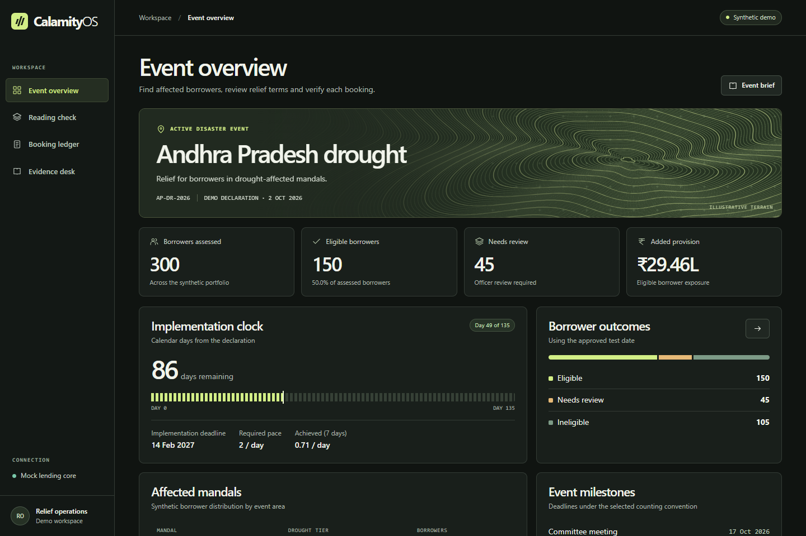
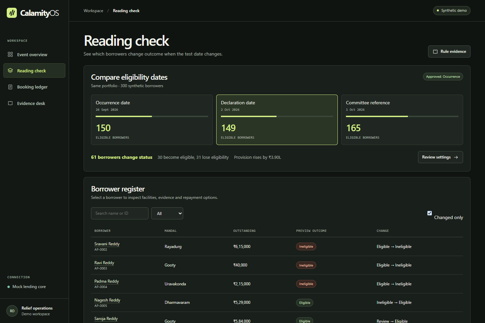
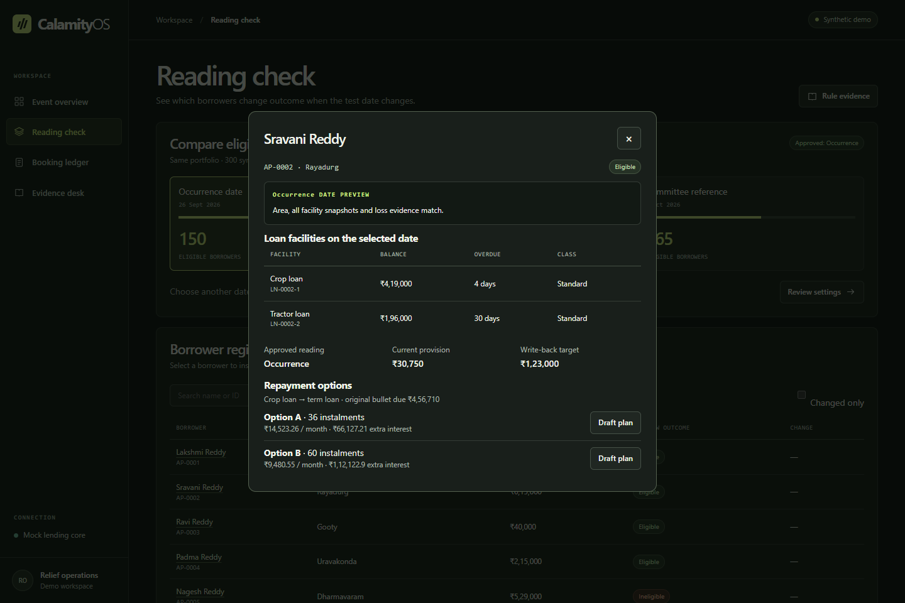
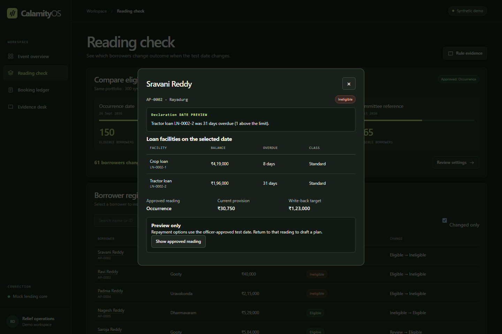
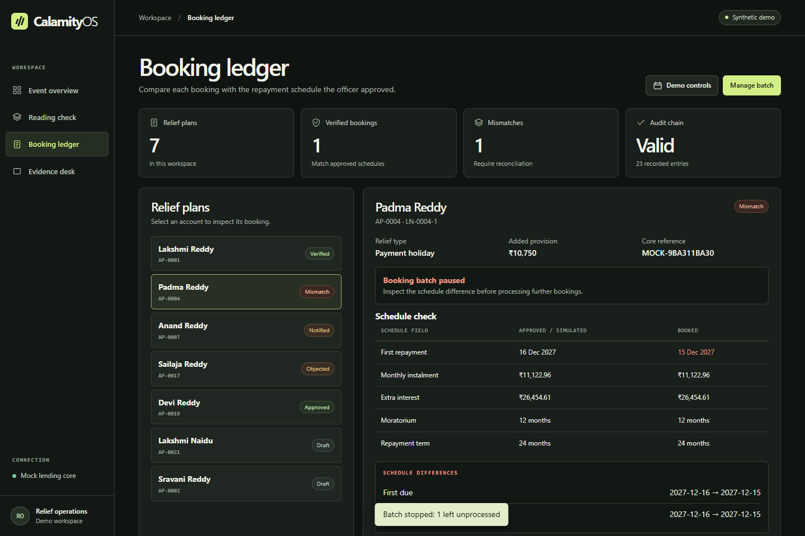
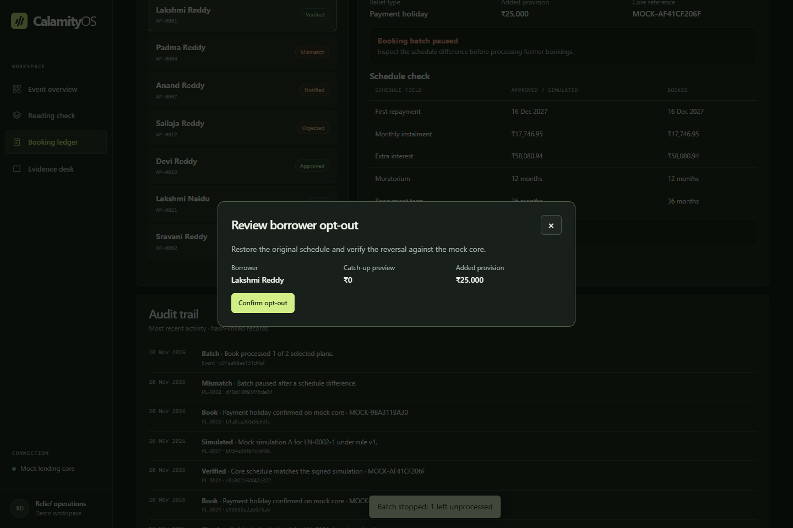
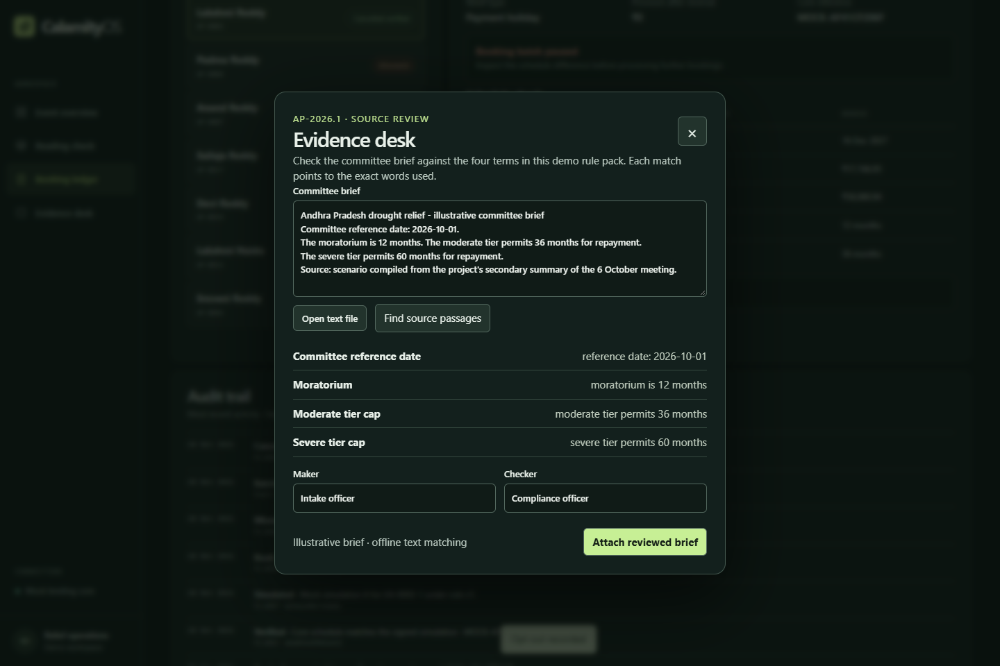

# CalamityOS

**Calamity relief operations for a bank, with the date choice, the booking check and the audit trail made explicit.**

CalamityOS walks a synthetic 300-borrower Andhra Pradesh drought portfolio through relief restructuring: deciding who qualifies on which date, pricing the repayment options, notifying the borrower, booking the plan on a lending core, and checking that what the core booked is what the officer approved. It runs offline, on the Python standard library, with no accounts and no network calls.

[Quick start](#quick-start) · [What it does](#what-it-does) · [Project layout](#project-layout) · [Testing](#testing) · [Scope and limitations](#scope-and-limitations)



## The problem

A state declares a drought. The bank does not receive a list of borrowers. It receives a committee decision, a gazette notification, an implementation window of 135 days, and a loan book where eligibility turns on details like whether a second facility was 30 or 31 days overdue on one particular date. Branch staff work through it in spreadsheets under deadline.

The failures that surface in a later audit are usually not arithmetic. They are the test date nobody questioned, the schedule the core system actually booked differing from the one that was approved, and no trail from a booked restructure back to the sentence that authorised it. CalamityOS is built around those three gaps.

## What it does

### The date choice changes the answer, so make it visible

Three dates compete in a real event: when the calamity occurred, when the state gazetted the declaration, and the reference date the bankers' committee adopted. The scenario keeps all three as separate fields instead of collapsing them into one.

Switching between them moves the portfolio from 150 eligible borrowers to 149 to 165. The 149 is the one worth showing: 30 borrowers become eligible and 31 lose eligibility at the same time, and the simulated additional provision moves by ₹3.90L. Filter to the 61 accounts that changed and open any of them to see the facility responsible.



Same borrower, two dates. On the occurrence date her tractor loan is 30 days overdue, she qualifies, and the repayment options are priced. On the declaration date it is 31 days overdue, one day past the limit, and she drops out of this relief route even though her crop loan is current.

<table>
<tr>
<td width="50%"></td>
<td width="50%"></td>
</tr>
<tr>
<td width="50%"><em>Occurrence date: 30 days overdue, eligible, two repayment options priced from the core simulation.</em></td>
<td width="50%"><em>Declaration date: 31 days overdue, ineligible, with the reason stated on the facility that caused it.</em></td>
</tr>
</table>

### Check what the core actually booked

Approving a plan freezes the simulated repayment schedule. After the booking request goes to the lending core, the booked schedule is read back and compared against that frozen approval field by field, plus the policy limits: tenor cap, moratorium length, extra interest, implementation deadline, and whether any instalment falls inside the payment holiday.

A repayment date shifted by one day produces a visible difference, pauses the rest of the batch, and lands in the audit trail. A missing core event leaves the plan pending instead of quietly passing. Re-sending a confirmation does not book a second time.



### Keep the borrower's choice in the workflow

Each plan carries a simulated notice with both repayment options priced from the core simulation, an objection window before booking, and an opt-out after it. An opt-out previews the catch-up amount, writes a compensating cancellation, restores the original schedule in the mock core and reverses the added provision.

Every action appends to a hash-linked ledger, and the chain is validated on each read, so an edit to a past entry shows up as an invalid chain.



### Tie the terms back to a source

The evidence desk takes a typed committee brief and pulls out the four terms the rule pack needs: reference date, moratorium length and the two tier caps. Each value carries the character span it came from, so clicking a term highlights the words behind it. A brief with a missing or conflicting term cannot be attached to the rule pack, and attaching one requires two different officer names.



### Show whether the deadline is reachable

The implementation clock compares the approval rate the deadline requires against the rate actually achieved over the last seven days, and projects a finish date from it. The event overview at the top of this page shows 2 per day required against 0.71 per day achieved.

## Quick start

Python 3.10 or newer. No dependencies to install.

```
git clone https://github.com/jabssyyy/calamityOS.git
cd calamityOS
python tasks.py ui --open
```

The workspace opens in your browser, bound to 127.0.0.1. On Windows, `Start CalamityOS.cmd` does the same with a double-click and uses a bundled `runtime\python.exe` if one is placed next to it.

| Command | What it does |
| --- | --- |
| `python tasks.py ui --open` | Start the workspace and open a browser |
| `python tasks.py demo` | Run the full path three times from fresh databases |
| `python tasks.py test` | Run the test suite |

Local state lives in `local-state/` and is reset from the workspace's demo controls.

## Testing

```
$ python tasks.py test
Ran 22 tests in 14.310s
OK
```

Coverage is where the decisions are: dated eligibility across every facility, the 30/31 day boundary, missing snapshots going to review, provisioning and write-back, repayment sizing, booking faults, duplicate requests, timeout recovery, batch pausing, notice and objection handling, officer separation, and ledger tamper detection.

`python tasks.py demo` is the one to run first. It walks the whole path three times from three fresh temporary databases, injecting a missing core event and a shifted repayment date, and asserts that all three runs end at the same audit hash:

```
$ python tasks.py demo
Three identical clean runs.
{
  "borrowers": 300,
  "readings": [150, 149, 165],
  "recovered": "VERIFIED",
  "opt_out": "CANCELLED_VERIFIED",
  "fault": "MISMATCH",
  "audit_tip": "1c4a10d8e39163adf2d26b609fb25cb4632e845d28c275baa5df8f63fb39b0a0"
}
```

## Project layout

```
calamityos/
├── domain.py      Rule pack and scenario: eligibility, tiers, sizing, provisioning
├── booking.py     Workflow and hash-linked ledger, backed by SQLite
├── mock_core.py   Lending core simulator, run as a separate process
├── intake.py      Term extraction with source spans, maker-checker gate
├── app.py         Loopback HTTP server and the single application boundary
├── study.py       Preparation and scoring tools for the independent studies
└── static/        Browser workspace, plain JavaScript against the JSON API
```

Four things worth knowing about the design:

1. The browser UI and the headless demo go through the same application boundary, so the demo exercises the real path rather than a parallel one.
2. The mock core is a separate process with a one-request-per-invocation JSON protocol, and it was written independently of the reconciliation code that grades it. A checker that shares assumptions with the thing it checks proves nothing.
3. Everything that decides an outcome is deterministic: dates, eligibility, money and schedule comparison. Nothing probabilistic sits in the decision path.
4. `domain.py` is pure functions with no I/O, which is what makes the three-way date comparison cheap to compute and easy to test.

The interface pairs every status colour with a text label, and charts carry their values directly rather than relying on a legend, following [GOV.UK status tags](https://design-system.service.gov.uk/components/tag/) and [Carbon chart anatomy](https://carbondesignsystem.com/data-visualization/chart-anatomy/).

## Scope and limitations

This is a working prototype on a synthetic scenario. Being specific about that is part of the point.

**Synthetic data.** The loan book, borrowers, loss list and approval history are invented. The occurrence date and the replay declaration date are illustrative, chosen so the three-date comparison has something to show. The workspace labels them as such on screen rather than hiding it.

**Simulated integrations.** The lending core is a simulator. Notices are not delivered anywhere. The two officer names simulate a maker-checker control rather than enforcing one against real identities.

**Deterministic extraction, not document AI.** The evidence desk uses pattern matching tuned to this scenario's brief. It proposes values with spans for a human to accept or reject, and that is the whole of the claim.

**No accuracy results are claimed.** Figures against human annotators and model baselines need the independent runs described in [the study protocol](calamityos/STUDY.md). The tooling for those runs (`python -m calamityos.study`) prepares blank sheets and scores completed ones; it deliberately does not generate answers.

Live core integration, real banking identities and general document extraction would each need separate validation.

## Sources

Rule references are to the RBI directions on the resolution of stressed assets and on income recognition, asset classification and provisioning. The Andhra Pradesh terms come from a secondary report of the 6 October special SLBC meeting together with the gazette declaration; primary minutes were not available, and the workspace marks that distinction on each source it displays. Lending event names and the amended-schedule review step follow the [Temenos lending lifecycle](https://developer.temenos.com/article/lending-events-lifecycle-guide) documentation.
